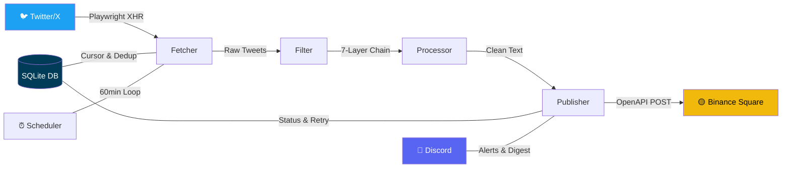

<div align="center">

<!-- Hero Banner -->


<br/>

<!-- Typing SVG -->
<a href="https://github.com/yansc153/twitter-binance-sync">
  
</a>

<br/><br/>

<!-- Gold Certification Badges -->

&nbsp;

&nbsp;


<br/><br/>

<!-- Tech Stack -->


<br/><br/>

<!-- Shields - Tech -->
[](https://python.org)
[](https://docker.com)
[](https://playwright.dev)
[](https://sqlite.org)
[](https://docs.python.org/3/library/asyncio.html)
[](https://www.binance.com/square)
[](https://x.com)
[](https://discord.com)

<!-- Shields - Repo -->
[](LICENSE)
[](https://github.com/yansc153/twitter-binance-sync/stargazers)
[](https://github.com/yansc153/twitter-binance-sync/network)
[](https://github.com/yansc153/twitter-binance-sync/issues)
[](https://github.com/yansc153/twitter-binance-sync/commits)
[](https://github.com/yansc153/twitter-binance-sync)
[](https://github.com/yansc153/twitter-binance-sync/pulls)

<br/>

---

**[English](#-english)** &nbsp;&bull;&nbsp; **[中文](#-中文)**

---

</div>

<br/>

## 🇺🇸 English

<div align="center">

### 💬 Just say this to Claude Code:

```
"Help me sync my tweets to Binance Square"
```

**That's it. Claude handles everything else.**

</div>

<br/>

### ✨ Features

<table>
<tr>
<td width="50%">

#### 🧠 Smart Filtering
7-layer filter chain automatically skips:
- ❌ Videos & GIFs (unsupported by Binance)
- ❌ Retweets (only original content)
- ❌ Replies & thread continuations
- ❌ Image-only & empty tweets

</td>
<td width="50%">

#### 🔄 Auto Retry & Dedup
- 🔁 Failed posts queued for retry (max 3x)
- 🔒 SQLite cursor-based deduplication
- ⏸️ Auto-pause on Binance daily limit
- 🕛 Auto-resume at midnight

</td>
</tr>
<tr>
<td width="50%">

#### 🐳 One-Command Deploy
```bash
docker compose up -d --build
```
- Playwright pre-installed
- Non-root container (security)
- Auto log rotation
- Memory-limited (768MB)

</td>
<td width="50%">

#### 🔔 Discord Notifications
- 🔴 Critical: Cookie expired, API key error
- 🟠 Error: Permanent publish failure
- 🟡 Warning: Daily limit, sensitive content
- 🔵 Info: Daily digest report

</td>
</tr>
</table>

### 🏗️ Architecture



### 🔑 What You Need

| | Item | Required | How to Get |
|---|------|:--------:|------------|
| 🐦 | **Twitter Username** | ✅ | The @handle you want to monitor |
| 🟡 | **Binance Square API Key** | ✅ | [Guide →](references/binance-api-guide.md) &nbsp; ⏱️ Creator approval: 24-48h |
| 🍪 | **Twitter Cookie (JSON)** | ✅ | [Guide →](references/twitter-cookies-guide.md) &nbsp; 🔧 via Cookie-Editor |
| 💬 | **Discord Bot Token** | ❌ | [Guide →](references/discord-bot-guide.md) &nbsp; Optional notifications |

### 🚀 Quick Start

> [!TIP]
> **Claude Code users**: Just say *"帮我把推文同步到币安广场"* — Claude will ask you 3 questions and handle everything automatically. No commands needed.

<details>
<summary><b>📋 Manual Setup (click to expand)</b></summary>

```bash
# 1. Generate project
python3 scripts/init_project.py \
  --twitter-username TARGET_HANDLE \
  --output-dir ~/twitter-sync

# 2. Configure credentials
cd ~/twitter-sync
# Edit .env → add your Binance API Key
# Copy Cookie-Editor export → cookies/twitter.json

# 3. Validate & deploy
python3 validate_config.py
docker compose up -d --build

# 4. Test (dry run, no actual posting)
docker exec twitter-sync python main.py --test
```

</details>

### 📁 Project Structure

<details>
<summary><b>Click to expand</b></summary>

```
twitter-binance-sync/
├── 📄 SKILL.md                    # Skill definition (Claude reads this)
├── 📖 README.md                   # You are here
├── 📜 LICENSE                     # MIT License
├── 🔧 scripts/
│   ├── init_project.py            # Project scaffolding
│   ├── validate_config.py         # Pre-deploy validation
│   └── health_check.py            # Runtime diagnostics
├── 📚 references/
│   ├── architecture.md            # Pipeline deep-dive
│   ├── twitter-cookies-guide.md   # Cookie export tutorial
│   ├── binance-api-guide.md       # API key setup
│   ├── discord-bot-guide.md       # Bot creation
│   ├── vps-deployment-guide.md    # Docker deployment
│   ├── troubleshooting.md         # Error codes & fixes
│   └── customization-guide.md     # Extend & customize
└── 📦 assets/templates/           # Complete deployable project
    ├── main.py                    # Entry point
    ├── Dockerfile                 # Non-root container
    ├── docker-compose.yml         # Orchestration
    └── modules/                   # Pipeline modules
        ├── fetcher.py             # Playwright tweet fetcher
        ├── filter.py              # 7-layer filter chain
        ├── processor.py           # Text cleanup
        ├── publisher.py           # Binance Square API
        ├── db.py                  # SQLite persistence
        ├── scheduler.py           # Sync orchestration
        └── notifier.py            # Discord notifications
```

</details>

### 📚 Documentation

| | Document | Description |
|---|----------|-------------|
| 🏗️ | [Architecture](references/architecture.md) | Data flow, SQLite schema, state machine, cursor |
| 🍪 | [Twitter Cookies](references/twitter-cookies-guide.md) | Cookie-Editor export walkthrough |
| 🟡 | [Binance API](references/binance-api-guide.md) | Key setup, endpoints, error codes |
| 💬 | [Discord Bot](references/discord-bot-guide.md) | Bot creation & channel config |
| 🐳 | [Deployment](references/vps-deployment-guide.md) | Docker install & deploy |
| 🔧 | [Troubleshooting](references/troubleshooting.md) | 7 common scenarios & fixes |
| ⚙️ | [Customization](references/customization-guide.md) | Filters, platforms, multi-account |

---

<br/>

## 🇨🇳 中文

<div align="center">

### 💬 对 Claude Code 说一句话就行：

```
"帮我把推文同步到币安广场"
```

**就这样。Claude 会帮你搞定一切。**

</div>

<br/>

### ✨ 功能特性

<table>
<tr>
<td width="50%">

#### 🧠 智能过滤
七层过滤链自动跳过：
- ❌ 视频和 GIF（币安广场不支持）
- ❌ 转推（只同步原创内容）
- ❌ 回复和线程续帖
- ❌ 纯图无文字、空内容

</td>
<td width="50%">

#### 🔄 自动重试与去重
- 🔁 发布失败自动排队重试（最多 3 次）
- 🔒 SQLite 游标去重，绝不重复发帖
- ⏸️ 检测到日限额自动暂停
- 🕛 午夜自动恢复

</td>
</tr>
<tr>
<td width="50%">

#### 🐳 一键部署
```bash
docker compose up -d --build
```
- Playwright 预装就绪
- 非 root 运行（安全）
- 日志自动轮转
- 内存限制 768MB

</td>
<td width="50%">

#### 🔔 Discord 通知
- 🔴 致命：Cookie 过期、API Key 失效
- 🟠 错误：推文永久发布失败
- 🟡 警告：日限额、敏感内容
- 🔵 信息：每日同步报告

</td>
</tr>
</table>

### 🔑 你只需要准备

| | 项目 | 必需 | 获取方式 |
|---|------|:----:|----------|
| 🐦 | **Twitter 用户名** | ✅ | 你想监控的 @用户名 |
| 🟡 | **币安广场 API Key** | ✅ | [教程 →](references/binance-api-guide.md) &nbsp; ⏱️ 创作者审批 24-48 小时 |
| 🍪 | **Twitter Cookie（JSON）** | ✅ | [教程 →](references/twitter-cookies-guide.md) &nbsp; 🔧 通过 Cookie-Editor 导出 |
| 💬 | **Discord Bot Token** | ❌ | [教程 →](references/discord-bot-guide.md) &nbsp; 可选通知功能 |

### 🚀 快速开始

> [!TIP]
> **Claude Code 用户**：直接说 *"帮我把推文同步到币安广场"*，Claude 只会问你 3 个问题，然后全自动完成配置和部署。**不需要你输入任何命令。**

<details>
<summary><b>📋 手动配置（点击展开）</b></summary>

```bash
# 1. 生成项目
python3 scripts/init_project.py \
  --twitter-username 目标用户名 \
  --output-dir ~/twitter-sync

# 2. 配置凭证
cd ~/twitter-sync
# 编辑 .env → 填入币安 API Key
# Cookie-Editor 导出 → cookies/twitter.json

# 3. 校验并部署
python3 validate_config.py
docker compose up -d --build

# 4. 测试（不实际发帖）
docker exec twitter-sync python main.py --test
```

</details>

### 📚 文档

| | 文档 | 说明 |
|---|------|------|
| 🏗️ | [架构说明](references/architecture.md) | 数据流、SQLite Schema、状态机、游标机制 |
| 🍪 | [Twitter Cookie 教程](references/twitter-cookies-guide.md) | Cookie-Editor 导出步骤 |
| 🟡 | [币安 API 教程](references/binance-api-guide.md) | API Key 申请、接口说明、错误码 |
| 💬 | [Discord Bot 教程](references/discord-bot-guide.md) | Bot 创建和频道配置 |
| 🐳 | [部署教程](references/vps-deployment-guide.md) | Docker 安装和部署流程 |
| 🔧 | [故障排查](references/troubleshooting.md) | 错误码对照、7 个常见场景 |
| ⚙️ | [自定义扩展](references/customization-guide.md) | 过滤规则、换平台、多账号 |

---

<div align="center">

<br/>

## ⭐ Star History

<a href="https://star-history.com/#yansc153/twitter-binance-sync&Date">
  <picture>
    <source media="(prefers-color-scheme: dark)" srcset="https://api.star-history.com/svg?repos=yansc153/twitter-binance-sync&type=Date&theme=dark" />
    <source media="(prefers-color-scheme: light)" srcset="https://api.star-history.com/svg?repos=yansc153/twitter-binance-sync&type=Date" />
    
  </picture>
</a>

<br/><br/>

### 💖 Support This Project

**If this helps you, a Star means the world!** ⭐

**如果对你有帮助，一个 Star 就是最大的支持！** ⭐

<br/>


&nbsp;

&nbsp;


<br/><br/>

<!-- Activity Graph -->


<br/>

<!-- Footer Wave -->


</div>
